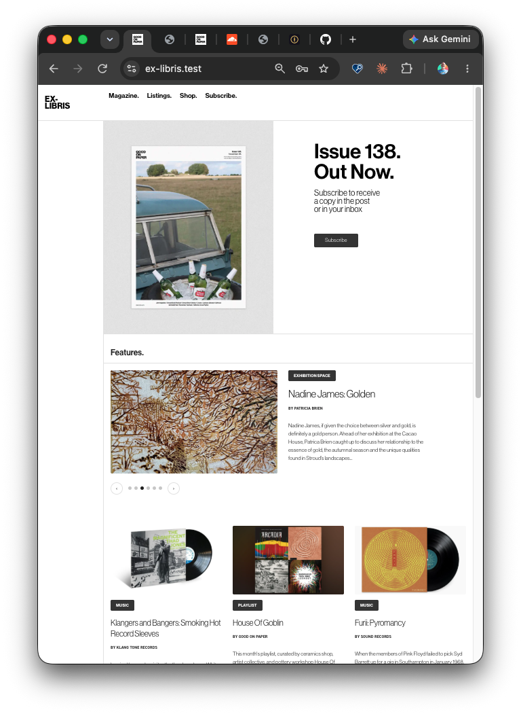
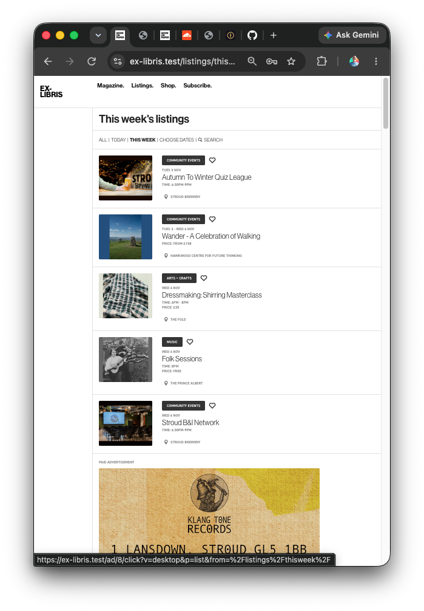

# Ex-Libris

[](https://github.com/UltraSimplified/Ex-Libris/actions/workflows/deploy.yml)


[](LICENSE)

An online magazine skeleton with event listings, a shop, promoter and venue pages, and integrated adverts, built on Laravel 13 and Nova 5.

Originally developed to complement the Good on Paper printed magazine for Stroud arts and culture, with support from Stroud District Council.



<details>
<summary><strong>Listings page</strong></summary>



</details>

## Contents

- [Features](#features)
- [Tech stack](#tech-stack)
- [Requirements](#requirements)
- [Installation](#installation)
- [Configuration](#configuration)
- [Usage](#usage)
- [Development](#development)
- [Deployment](#deployment)
- [Project structure](#project-structure)
- [Contributing](#contributing)
- [Credits](#credits)
- [Licence](#licence)

## Features

**For readers**

- **Event listings** by day, week, genre, venue and promoter, with search, a calendar file for each event, and bookmarks with a "Going" tick.
- **Magazine features** and writers' pages, with galleries, video and audio embeds, and the archive of printed issues.
- **Stockists**, showing where to pick up the printed magazine.
- **Shop** with a basket and Stripe Checkout through Laravel Cashier, plus order history.
- **Adverts and sponsorship**, set among the listings and at the foot of every page, with impressions and clicks counted.

**For promoters, venues and publishers (Backstage)**

- Promoters and venue managers add and edit their own listings, with a line-up, a gallery, ticket links and specific days for a run.
- Publishers build embeddable **gig widgets** that show listings on their own websites.
- Every account has its bookmarks, its purchases and its settings, including two-factor authentication.

**For the editorial team (the Office)**

- A Laravel Nova admin at `/office` for listings, features, writers, issues, pages, venues, promoters, stockists, adverts, products and orders.
- Custom Nova fields for galleries, video embeds and specific days, in `nova-components/`.
- A report for each advert, a CSV export of listings, and packing slips for shop orders.

## Tech stack

| Layer | Built with |
| --- | --- |
| Back end | [Laravel 13](https://laravel.com), [Fortify](https://laravel.com/docs/fortify) for authentication, [Cashier](https://laravel.com/docs/billing) for Stripe |
| Admin | [Laravel Nova 5](https://nova.laravel.com) with [Flexible Content](https://github.com/whitecube/nova-flexible-content) and [Nova 5 Image Cropper](https://github.com/UltraSimplified/nova5-image-cropper) |
| Front end | [Inertia.js 2](https://inertiajs.com), [Vue 3](https://vuejs.org), TypeScript, [Tailwind CSS 4](https://tailwindcss.com), [Wayfinder](https://github.com/laravel/wayfinder) |
| Media | [Intervention Image 4](https://image.intervention.io), Digital Ocean Spaces (S3-compatible storage behind a CDN) |
| Testing | [Pest 4](https://pestphp.com) with browser tests run in Playwright |
| Code quality | Pint, PHPStan (Larastan), Sloppy, ESLint, Prettier, vue-tsc |

## Requirements

- **PHP 8.4 or later** (CI runs 8.5), with the `bcmath`, `gd`, `intl`, `pdo_mysql`, `pdo_sqlite`, `sockets` and `zip` extensions
- **Composer 2**
- **Node.js 24** (the version CI uses) and npm
- **MySQL 8** or another database Laravel supports
- **A [Laravel Nova](https://nova.laravel.com) licence**: Nova is commercial software and is installed from its own Composer repository

For the full site you will also want:

- An **S3-compatible bucket** with a CDN in front of it, for uploaded images (the configuration is written for DigitalOcean Spaces)
- A **Stripe** account, if you run the shop
- A **[Lettr](https://lettr.com)** account, or any other Laravel mail driver, for sending mail

## Installation

1. **Clone the repository.**

   ```bash
   git clone https://github.com/UltraSimplified/Ex-Libris.git
   cd Ex-Libris
   ```

2. **Give Composer your Nova credentials**, using your Nova account's email address and your licence key.

   ```bash
   composer config http-basic.nova.laravel.com your-email@example.com your-nova-licence-key
   ```

3. **Install the dependencies and set up the environment.**

   ```bash
   composer install
   cp .env.example .env
   php artisan key:generate
   ```

   Then open `.env` and fill in at least `APP_URL`, the `DB_*` settings and `NOVA_LICENSE_KEY`. See [Configuration](#configuration) for the rest.

4. **Create the database tables.**

   ```bash
   php artisan migrate
   ```

5. **Publish the cookie banner's assets.** These live in `public/vendor`, which is not committed, and every page needs them.

   ```bash
   php artisan vendor:publish --tag=cookies-consent-public
   ```

6. **Build the front end.**

   ```bash
   npm ci
   npm run build
   ```

7. **Let yourself into the Office.** Access is given to the email addresses in `User::OFFICE_EMAILS` in [`app/Models/User.php`](app/Models/User.php). Add your own, then register an account with that address at `/register`.

> [!TIP]
> `composer run setup` runs steps 3, 4 and 6 in one go: it installs, copies `.env.example` if there is no `.env`, generates the key, migrates and builds. You still need steps 2, 5 and 7.

## Configuration

Everything is set in `.env`. `.env.example` lists every key with blank values for you to fill in.

| Area | Keys | Notes |
| --- | --- | --- |
| Application | `APP_NAME`, `APP_URL`, `APP_ENV`, `APP_DEBUG` | Set `APP_DEBUG=false` in production. |
| Database | `DB_CONNECTION`, `DB_HOST`, `DB_PORT`, `DB_DATABASE`, `DB_USERNAME`, `DB_PASSWORD` | Sessions, cache and the queue use the database by default. |
| Office | `NOVA_LICENSE_KEY`, `NOVA_STORAGE_DISK` | The Office is served at `/office`. |
| Media | `DO_ACCESS_KEY_ID`, `DO_SECRET_ACCESS_KEY`, `DO_DEFAULT_REGION`, `DO_BUCKET`, `DO_FOLDER`, `DO_URL`, `DO_ENDPOINT`, `DO_CDN_ENDPOINT`, `CDN_URL` | Uploaded images are stored on the `do` disk and served from `CDN_URL`. |
| Mail | `MAIL_MAILER`, `MAIL_FROM_ADDRESS`, `MAIL_FROM_NAME`, `LETTR_API_KEY` | Lettr refuses a From address unless its domain is verified in your Lettr account. |
| Shop | `STRIPE_KEY`, `STRIPE_SECRET`, `STRIPE_WEBHOOK_SECRET`, `CASHIER_CURRENCY`, `SHOP_CHECKOUT_ENABLED`, `SHOP_CHECKOUT_EXPIRES_AFTER`, `SHOP_NOTIFY_TO`, `SHOP_NOTIFY_CC` | Checkout is off until `SHOP_CHECKOUT_ENABLED=true`. Use Stripe's test keys outside production, and point a Stripe webhook at `/stripe/webhook`. |
| Listings and adverts | `LISTINGS_ADVERT_EVERY`, `GEO_DRIVER` | An advert goes in after every `LISTINGS_ADVERT_EVERY` listings. `GEO_DRIVER=cloudflare` reads visitors' locations from Cloudflare's headers for advert reports. |
| Gig widgets | `WIDGETS_DOMAIN` | The domain the embeddable widget is served from. |
| Development | `BOOST_ENABLED`, `TIME_MACHINE_ENABLED` | Laravel Boost's tools for AI agents, and Laravel Time Machine, a request profiler that is on whenever `APP_DEBUG` is unless set. Keep both off in production. |

## Usage

### Running the site locally

With [Laravel Herd](https://herd.laravel.com), the site is served at a `.test` address named after its folder, such as `ex-libris.test`, as soon as the folder is linked. Run Vite alongside it for hot reloading:

```bash
npm run dev
```

Without Herd, one command starts the web server, a queue worker, the log viewer and Vite together:

```bash
composer run dev
```

### Where things are

| Address | What it is |
| --- | --- |
| `/` | The magazine's home page |
| `/listings` | Event listings, with `/listings/today`, `/listings/thisweek` and other views |
| `/magazine/features`, `/magazine/archives`, `/magazine/stockists` | Features, past issues and stockists |
| `/shop` | The shop |
| `/dashboard` | The Dashboard: bookmarks and purchases for every account, listings for promoters and venues, gig widgets for publishers |
| `/office` | The Office (Nova), for the editorial team |

Accounts are given their roles in the Office. An account linked there to a promoter or a venue can add listings for it, and an account marked as a publisher can make gig widgets.

### Scheduled tasks and the queue

Add Laravel's scheduler to the server's crontab:

```bash
* * * * * cd /path/to/ex-libris && php artisan schedule:run >> /dev/null 2>&1
```

The scheduler also runs the queue worker every minute until the queue is empty, so a host without a long-running process can still send mail and run jobs.

### Artisan commands

| Command | What it does | Scheduled |
| --- | --- | --- |
| `bookmarks:prune` | Removes bookmarks for events that have finished | Daily, 03:20 |
| `galleries:prune` | Removes Photojournal photos that no feature shows | Daily, 03:40 |
| `shop:reconcile-orders` | Asks Stripe about orders still awaiting payment, in case a webhook was missed | Hourly |
| `venues:locate` | Puts on the map every venue with a postcode but no place yet | |
|
The scheduled commands only report what they would do unless given `--commit`, as the schedule does. Run `php artisan <command> --help` for the options.

## Development

### Tests

The tests use an in-memory SQLite database, so they never touch yours.

```bash
# Feature and unit tests
php artisan test tests/Feature tests/Unit

# Browser tests, after a one-off install of the test browser
npx playwright install chromium
php artisan test tests/Browser --parallel
```

The browser tests drive the built front end, so run `npm run build` first after any front-end change.

> [!NOTE]
> `php artisan test` refuses to run while the configuration is cached. Run `php artisan config:clear` first, or use `composer test`, which clears it, checks formatting and runs the whole suite.

### Code quality

| Command | What it checks |
| --- | --- |
| `composer lint` | Formats PHP with Pint |
| `composer test:lint` | Checks PHP formatting without changing anything |
| `composer analyse` | Runs PHPStan (Larastan) and the Sloppy code-smell analyser |
| `npm run lint` | Lints and fixes TypeScript and Vue with ESLint |
| `npm run typecheck` | Type-checks the front end with vue-tsc |

CI runs `composer test:lint`, `composer analyse` and every test suite on each push to `main`.

### Custom Nova fields

The Office's custom fields live in `nova-components/` and are installed as local Composer packages. Their built files are committed, so rebuild one after changing it:

```bash
npm run build:nova-gallery
npm run build:nova-video-embed
npm run build:nova-specific-days
```

### Routes in TypeScript

[Wayfinder](https://github.com/laravel/wayfinder) generates typed functions for every route when Vite builds. If you cache routes locally, run `php artisan route:cache` again after adding a route, or the build leaves it out.

## Deployment

[`.github/workflows/deploy.yml`](.github/workflows/deploy.yml) tests every push to `main`. It can then deploy over SSH, first to staging and, if staging succeeds, to production. Neither deploy runs until it is switched on.

Each deploy runs the waiting database migrations. A manual run (**Run workflow**) can leave them out, and then deploys nothing while a migration is waiting.

To use it with your own servers, set:

- **Repository variables:** `DEPLOY_STAGING_ENABLED` and `DEPLOY_LIVE_ENABLED`, each `true` to switch that deploy on
- **Repository secrets:** `COMPOSER_AUTH` (your Nova credentials, as Composer's `http-basic` JSON), `DEPLOY_KNOWN_HOSTS` and `DEPLOY_SSH_PORT`
- **Secrets on the `staging` and `production` environments:** `DEPLOY_SSH_KEY` and `DEPLOY_SSH_TARGET`

The deploy steps themselves are in [`.github/workflows/deploy-to.yml`](.github/workflows/deploy-to.yml). The runner installs the Composer packages and builds the front end, then copies them across with rsync, so the server needs PHP and rsync but neither Composer nor Node. Each server keeps its own `.env`, which is never uploaded or committed.

## Project structure

```text
app/
├── Http/Controllers/       Public pages, with Dashboard/ for the Dashboard
├── Models/                 Eloquent models
├── Nova/                   The Office's resources, fields and metrics
├── Services/               Listings, adverts, widgets, images and the shop
└── Support/                Small helpers, such as affiliate links and page meta
nova-components/            Custom Nova fields: Gallery, SpecificDays, VideoEmbed
resources/js/
├── pages/                  Inertia pages
├── components/GOP/         The public site's components
└── components/dashboard/   The Dashboard's components
openspec/                   Specifications and change proposals (OpenSpec)
tests/
├── Feature/                HTTP, model and command tests
├── Unit/                   Tests that need no framework
└── Browser/                Pest browser tests, run in Playwright
```

## Contributing

Issues and pull requests are welcome. Before opening a pull request:

1. Add or update tests for what you change.
2. Run `composer test:lint`, `composer analyse`, `npm run lint` and `npm run typecheck`.
3. Run the Feature, Unit and Browser suites, as CI does.

The coding rules that AI agents must follow in this repository, including the Sloppy rules, are in [`AGENTS.md`](AGENTS.md) and [`CLAUDE.md`](CLAUDE.md).

## Credits

**Development:** Robin Layfield, [UltraSimplified](https://github.com/UltraSimplified)

**Design:** Adam Hinks, Good on Paper

Originally made for **Good on Paper**, Stroud's arts and culture magazine, with support from **Stroud District Council**.

Built on the work of the teams behind Laravel, Laravel Nova, Inertia.js, Vue, Tailwind CSS, Pest and the other open-source packages in `composer.json` and `package.json`.

Special honours go to Pest developer Nuno Maduro @nunomaduro for being an inspiration in the world of PHP development.

## Licence

Ex-Libris is open-source software released under the [MIT licence](LICENSE).

Laravel Nova is commercial software and is not covered by this licence: you need a Nova licence of your own to run the Office.
